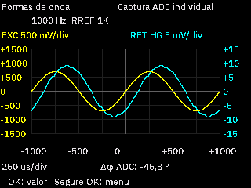

# Third result page: physical ADC waveform snapshot

Status: **IMPLEMENTED_REQUIRES_BENCH_VALIDATION**. The production image and API 7
resources are installed and byte-for-byte verified on the first unit. No DUT
acquisition or serial OK was requested during delivery.

## Behavior

DOWN cycles value, details, waveforms; UP reverses it. The graph enters 320x240
landscape and every exit restores portrait. Short OK returns to the value without
measurement; long OK opens the menu. Missing/incompatible snapshots retain a
navigable unavailable page.

Yellow EXC and cyan RET show a real, individual 256-sample ADC capture from an
accepted final-condition statistical repeat, copied before DMA acknowledgement.
Publication waits for the completed seven-sample estimate and SAFE teardown.
Simultaneous EXC1/RET1X or EXC2/RETHG pairs retain their physical ADC scales and
corresponding mean VMID. HG is explicitly labeled and not de-embedded. Both curves
share one interpolated positive-zero-crossing trigger; ADC phase is distinct from
impedance phase. The numeric RLC value remains the trimmed estimate.

Two periods span eight time divisions and six voltage divisions. The five signed
time ticks use 25 ms/div, 250 us/div or 25 us/div at 10 Hz, 1 kHz or 10 kHz.
Independent colored mV axes use 1–2–5 scales and 10% peak headroom. The renderer
streams <=64 pixels per step, including real-font rows. Quiet and generation
cancellation remain enforced. No framebuffer, heap, extra acquisition, relay
cycle, persistent waveform or new DMA is introduced.

This is a software preview, not a photograph or a measured DUT result.

## Installed identity and preservation

- Production source: `3f9e1a65ca0a` (clean source recorded in the sealed manifest).
- Unit: `54ff70068370525760380567`; configured 128 KiB remains specific to this
  previously tested device. The factory size register still declares 64 KiB.
- BIN: 79,644 B; SHA-256
  `2af412eb90cb32f9d977f779c19b042a1e0ccdf82e017a9529ac76065bd375d5`.
- API 7 pack: 108,975 B, all 911 frames acknowledged and complete external
  readback equal to SHA-256
  `e488ff36fa78f962e3aaec7b495e358ae89f37456e30029c6ee41b56d65bdf41`.
- Both owner image payloads match the prior API 6 pack exactly. Splash orientation
  and its completed-image three-second hold are unchanged.
- The complete 40-KiB mutable tail is byte-identical to the fresh preprogram
  snapshot: SHA-256
  `8825cacce71cecbc652228bca75e83b042269dbc58d2918dc765e9e6a736fdff`.
  Factory OSL sequence 1/all 33 conditions, lead slots, schema-5 settings and the
  compiled experimental NTC profile are preserved. No LOAD campaign is repeated.
- Final boot: one SAFE_BOOT, READY, no faults, K1 SAFE, range disabled, loaded
  settings, calibration active and zero acquisition sessions. Actual port COM3;
  final read-only preservation telemetry reports 4.018 V, charger absent.
  Numeric battery readings came from UART.

## Memory and stack evidence

| Configuration | Flash | Accounted RAM | Stack floor |
| --- | ---: | ---: | ---: |
| Installed unit128 product | 79,644 B | 17,496 B | 2,048 B |
| Diagnostic with stack paint | 79,352 B | 17,416 B | 2,048 B |
| Largest unit128, supplementary curves ON | 82,376 B | 19,328 B | 2,048 B |

The installed product has 51,428 B of physical Flash free and 2,984 B beyond
accounted RAM. The static/accounted increment is 2,208 B against the approved
2,304-B limit. The two-slot store is 2,176 B; it is not allocated by generic 64-KiB or
BRINGUP profiles. Unit128 preferred/hard accounted limits are 18/19 KiB;
generic product and bringup retain 17/18 KiB. Package inspection uses the same
resolver as the build, and the stack floor is never silently reduced.

Actual diagnostic stack paint first found only **252 B** of unused prefix after
resource update, below the required 512 B. The failed checkpoint is retained.
Initialization, product control, rendering and serial processing now have
sequential, non-overlapping temporary-frame lifetimes under LTO. Initialization
IO records were audited for copied ownership before returning. No static buffer
or reserve increase was used. Fresh measurements leave **940 B after boot** and
**908 B after resource update** (observed high-water 1,140/2,048 B). These results
cover only exercised boot/resource/idle paths, not acquisition, waveform-page,
menu or broader fault paths. Those remain REQUIRES_BENCH_VALIDATION.

## Verification and artifacts

67/67 full host entries, 532 Python cases with 38 explicit optional skips, four
provisioning-OFF app/session/UI checks and 28 strict bilingual real-font/fallback
waveform previews pass. Tests cover quantized phases at all three frequencies,
simultaneous rank selection, independent scales, trigger failure/clipping,
discarded repeats, earlier autorange winners, before-acknowledge copying, SAFE
cleanup failures/cancellation, provenance, navigation/rotation, quiet, obsolete
generations, bounded rendering and SPI failure paths.

All nine supported embedded profiles pass, including supplementary curves and
the diagnostic stack build. Generic full product retains the expected 64-KiB
budget stop. The final source change after host checks affects only foreground
board orchestration; pure/session/product/UI sources are identical. Its complete
embedded matrix and actual programming/boot/update/stack evidence are recorded.
Earlier API expectation/fallback failures are retained alongside corrected passes.

- [Sealed installed firmware](firmware.zip), [matched resource pack](product-api7.wrp2)
  and [resource summary](product-api7-summary.json).
- [Instrumented diagnostic image](diagnostic-firmware.zip), used only for the
  recorded stack observation and subsequently replaced by production.
- [266-file indexed evidence](evidence.zip), [delivery report](report.json),
  [checksums](checksums.json) and [preview sheet](waveform-previews.png).
- [Plan 34](../../../../plans/34-Measurement-Waveform-Snapshot.md).

With the display connected, later confirm resistor, 103J100 and 470-uH curves,
amplitudes, phase sign, units, orientation, navigation and final SAFE. Also
exercise diagnostic stack high-water in those paths. No physical accuracy,
visual gain, timing or component-envelope qualification is inferred here.
