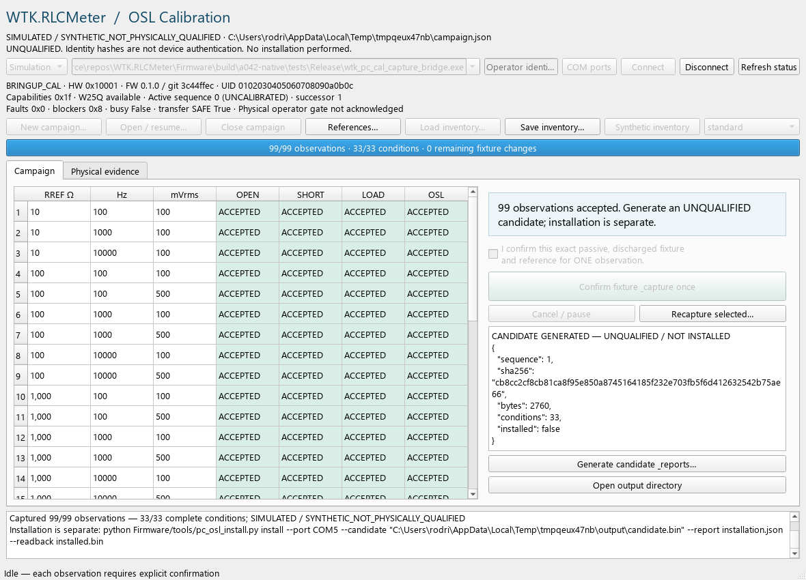

# A04.2 — Windows calibration desktop evidence

Status: **IMPLEMENTED_TESTED_HOST / REQUIRES_BENCH_VALIDATION**. No assembled
board, physical COM capture, electrical approval or accuracy qualification.

Starting main: `3c44ffec902ea22d90becb741df0eefce862f572`; PR #17 confirmed merged.
Clean checkout preserved, fetch/prune, main fast-forward, recursive submodules,
branch `codex/a04-desktop-calibration-workbench`. Python 3.9.5 x64,
PySide6-Essentials/shiboken 6.8.3, pyserial 3.5, PyInstaller 6.13.0,
MSVC 19.44.35228.0, CMake 4.4.4, Arm GCC 14.2.1 (20241119).

## Working application

- [Desktop](../../../Firmware/tools/pc_osl_workbench.py): Qt Widgets main window,
  connection/status panel, 33-condition OPEN/SHORT/LOAD matrix, fixture confirmation,
  capture/cancel, observation/solver inspection, inventory forms, physical-evidence
  tab/operator review dialog and candidate/report export. No installation action.
- [Worker-owned operations](../../../Firmware/tools/pc_osl_workbench_model.py):
  calls the unchanged Campaign persistence/locking, Client framing/capture/CANCEL,
  OSL solver and strict candidate validator. No second database or fitting engine.
  One persistent QThread owns the port and campaign; at most one operation is
  queued. GUI receives copied snapshots/signals and never sends serial commands.
- [Windows operating/packaging guide](../../../Firmware/tools/PC_OSL_WORKBENCH.md),
  pinned runtime/build manifests, launch script and onedir packaging recipe.
  [License review](../../../Firmware/tools/WORKBENCH_LICENSES.md) covers Qt/PySide,
  pyserial/Python and PyInstaller's bundling exception with upstream sources.
- [Model tests](../../../Firmware/tests/tools/test_pc_osl_workbench_model.py) and
  [actual Qt interactions](../../../Firmware/tests/tools/test_pc_osl_workbench_qt.py).
  Headless GUI dependencies are installed in the existing CI regression workflow.
- The only existing backend edit hides the native C fixture's Windows console
  window; serial framing, capture, mathematics and persistence are unchanged.
  No embedded C, BSP, CMake/linker, PCB/BOM, protocol/schema or memory-gate edit.



The reference dialog loads/saves the existing six-reference format and calls
`references()` for tolerance/interval/passivity/provenance validation. Unknown
fields remain unknown. Actual complex values require independent provenance;
printed tolerance and independently measured intervals stay distinct. A bound
campaign inventory is read only; close it before editing a NEW campaign inventory.

Default order is 33 OPEN, 33 SHORT, six groups of LOAD: eight fixture setups,
seven changes, **99 separate checkbox + Capture confirmations**. The app advances
the displayed instruction only, never acquires the next record automatically.
Quality includes source/return peaks, usable 1X/HG, clipping, accepted repeats,
temperature if reported, nominal ADC provenance, acquisition errors and raw SHA.
Complete triplets show the existing solver's path/separation/coefficients.
Rejected cells/condition REVIEW and prior rejected-attempt reasons remain inspectable.
Explicit recapture preserves previously accepted evidence in the canonical audit.

## Physical authority and recovery

Physical mode identifies real BRINGUP_CAL, uses 3.3 V USART1/115200 8N1 and keeps
DTR/RTS deasserted. Before each capture it checks identity, safety, installation
availability and the bound active/successor sequences, then calls the existing
Campaign capture guard. Nominal ADC metadata is not fabricated or called calibrated.
Reported Git prefix/UID is an identity binding, not cryptographic authentication.

B01 session/report import retains source SHA and original metadata/checks inside
the existing campaign seal. Simulated/replayed evidence cannot satisfy physical
prerequisites. The generic `physically_validated=false` field neither approves nor
rejects evidence. Missing manual measurements/inspection and STOP/UNKNOWN diagnostics
are listed; actual assembly/rails/safe outputs/analog prerequisites are required.
A separately dated/named operator review binds the inspected board, interlock and
clamp-risk authorization, instruments and separate SWD transition. BRINGUP and
BRINGUP_CAL need not have identical Git banners. Full deployed capture SHA must
match its reported prefix. Operator permission is scoped to passive capture,
not a safety/accuracy certificate, and is renewed after reconnect/failure.

Cancellation is an event observed between requests on the serial owner, followed
by existing STATUS/CANCEL teardown. A START acknowledgement is never blindly retried.
Unknown cancellation/disconnection blocks capture and prominently says keep the
fixture unchanged; firmware's independent timeout remains authoritative. Disconnect
is unavailable while acquiring; cancel/drain first. Window close requests teardown,
waits for the worker and releases transport. No thread termination/reset/force action.
Changing identity, ADC provenance, active sequence or artifact integrity is rejected.

## Synthetic demonstration and regression

The actual Qt window and C-backed PLC1 parser/session/DSP collect 42 observations
in a separate GUI process. It exits abruptly with `os._exit(17)`, without cleanup.
A fresh window/process-owned device reloads the sealed campaign and resumes at 43.
The first 42 hashes survive; all 99 explicit test-only confirmations yield 33 usable
triplets. Existing solver/serializer/installer validator accepts a **2760-byte**
schema-v2/model-v4 candidate, sequence 1, SHA-256
`cb8cc2cf8cb81ca8f95e850a8745164185f232e703fb5f6d412632542b75ae66`.
The synthetic device remains blank/installation IDLE. No Flash writing occurs.
Reports retain references, uncertainty assumptions, raw audit and desktop B01/operator
provenance. Everything synthetic is visibly SIMULATED / UNQUALIFIED.

Reproduction:

```powershell
Firmware/build/a042-env/Scripts/python.exe Firmware/tools/product_factory_matrix.py --host --out Firmware/build/a042-host
python Firmware/tools/product_factory_matrix.py --out Firmware/build/a042-baseline
python Firmware/tools/product_factory_matrix.py --out Firmware/build/a042-final
```

The environment uses the committed pinned manifest; paths are examples, not dependencies.
New tests cover UI interlocks, inventory, evidence separation, identity/ADC corruption,
atomic reload, explicit recapture, real C cancellation, communication ambiguity,
GUI timer responsiveness, duplicate actions, GUI thread delivery/worker cleanup,
abrupt exit at 42, complete candidate and runtime command allowlist (no installation).
Eight host combinations (Debug/Release × legacy/factory × curves OFF/ON) pass:
**336 CTest invocations** and the complete **350-test Python suite/configuration
(2800 invocations)**, zero failures/skips. The **44 new desktop tests** were then
rerun against each configuration's C fixture after the final resume-UNKNOWN guard
(352 additional successful invocations). Legacy/factory CTest counts are 40/41
OFF and 43/44 ON in each build type. Existing PC/C solver/golden frames, Resource
Pack, capture, installation/readback, PRODUCT runtime and 66 store-transition /
125 partial-NOR interruption sweeps remain passing. Seventeen PCB extraction/doc
checks pass. All 12 ARM images pass A01 physical/project size and composition gates.

Local Wokwi file checks, custom-chip compilation and CLI lint pass; smoke was
attempted but not executed because `WOKWI_CLI_TOKEN` is absent. No virtual scenario
or physical pass is inferred. Hosted CI/account status is separate.

Windows x64 onedir packaging was actually built with the pinned manifest, including
the Release **/MT** native C fixture, replaceable Qt DLLs, source/metadata/notices
and operating guide (approximately 86.3 MB, ignored). The bundled executable's
offscreen startup/cleanup exits 0; the included fixture also passes the full 44-test
desktop suite. Actual Qt 99-observation interactions are tested from source; an
entire 99-click packaged-executable interaction on a clean Windows machine is still
pending. No physical COM device was opened. This is an unsigned local test bundle,
not a signed/released or legally cleared public binary distribution.

## Fresh firmware evidence

[workbench-sizes.csv](workbench-sizes.csv): 12/12 starting-SHA programmed binaries
byte-identical; **all Flash/accounted-RAM/stack deltas zero**. Debug ELF paths can
differ; rebuilding at another Git commit updates banner metadata only.

| Profile / curves | Before = after Flash B | Before = after RAM B | Stack B |
| --- | ---: | ---: | ---: |
| Legacy Debug OFF / ON | 58,700 / 61,312 | 14,536 / 14,600 | 2048 |
| Legacy Release OFF / ON | 62,044 / 64,468 | 14,984 / 15,048 | 2052 |
| Factory Debug OFF / ON | 51,728 / 54,208 | 14,832 / 14,896 | 2052 |
| Factory Release OFF / ON | 52,648 / 55,124 | 15,040 / 15,104 | 2052 |
| BRINGUP OFF / ON | 65,448 | 14,596 | 2048 |
| BRINGUP_CAL OFF / ON | 31,944 | 12,744 | 2048 |

## Remaining physical/release gates

R02 backlight link open until characterized; R05 Bluepill header/power/SWD/HSE
inspection; bank/bypass population and K2/TVS DNP; actual power modules/buzzer;
current-limited rails/safe boot/charger/residual/K1/range and 5V analog clamp
injection into 3V3. Ground scope probes only at actual GND, never VMID/RET/TEST.
Firmware cannot eliminate injection. Only separately authorized passive fixtures.

Then one controlled OPEN capture through the GUI, source/ADC/HG/fixture observability
checks, full physical campaign, independent R/C/L holdouts and separately authorized
installer/readback/reset/interruption evidence. Unsupported physical conditions
remain unresolved, never fabricated. Deploy standalone PRODUCT through SWD after
provisioning. Absolute accuracy, legacy-wizard retirement, plots/scope import and
supplementary fitting are outside this milestone. Clean Windows 10/11 deployment,
signing and complete redistribution license/source notices remain release gates.
