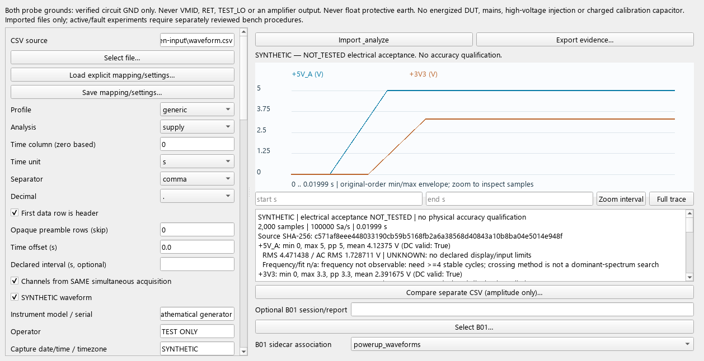

# A04.3a — oscilloscope CSV evidence and analog bring-up

Status: **IMPLEMENTED_TESTED_HOST / REQUIRES_BENCH_VALIDATION**.
No assembled-board waveform, physical accuracy or electrical approval is claimed.

Starting main: `5339cae3315b515c1238642b06e85984895c17b8`, PR #18 confirmed merged.
Clean checkout preserved, fetch/prune, fast-forward synchronization and recursive
submodules; branch `codex/a043-scope-evidence`. Python 3.9.5 x64, Qt/PySide Essentials
6.8.3, CMake 4.4.4, MSVC 19.44.35228.0, Arm GCC 14.2.1 (20241119). Existing pinned
dependencies remain unchanged. The implementation is entirely PC-side.

## Delivered workflow

- [scope_waveform.py](../../../Firmware/tools/scope_waveform.py): bounded explicit
  generic CSV parsing, source SHA/acquisition settings, descriptive metrics,
  crossing-frequency/cosine fits, supply/excitation/clamp/RET presets, independent
  amplitude comparison, min/max envelopes and deterministic evidence bundles.
- [scope_workbench.py](../../../Firmware/tools/scope_workbench.py): existing desktop's
  Oscilloscope tab, mapping/settings forms, waveform plot/zoom, metrics, separate-file
  comparison and B01 sidecars. One independent worker owns arrays; Qt receives bounded
  envelopes. No serial-client access. Closing drains both workers.
- [scope_synthetic.py](../../../Firmware/tools/scope_synthetic.py): reproducible analytic
  signals, not proprietary Hantek export imitations or measured board recordings.
- [Operating guide](../../../Firmware/tools/PC_SCOPE_WAVEFORM.md): Windows examples,
  scaling/probe rules, numerical policies, component mapping, electrical safety and
  exact remaining native-format evidence requirements.



Generic UTF-8 numeric CSV with explicit columns/units/scales and probe compensation
works now. Header units must agree; raw ADC codes are refused; preambles are skipped
only explicitly. Scientific notation/dot-comma conventions are tested. No unknown
time interval, scale, probe or coupling is invented.
**Hantek DSO2C10 native layout remains explicitly unsupported**, with sample submission
instructions: the official page confirms CSV support, not a byte-level scaling
contract. Supply an unchanged real export and instrument/settings/probe evidence
before a native adapter is implemented. No SCPI or binary LWF parser.

Supply preset reports observed transitions/order/overshoot and regulator-inactive
observations without inventing a permitted delay. Excitation subtracts simultaneous
VEXC/VMID, fits 100/1k/10k Hz and qualifies 450 kHz projection availability. Clamp
estimates fitted series-resistor current; **diode current and actual +3V3 injection
remain unavailable**. RET compares shared-frequency gain/phase: nominal 15.47 is
context, not an acceptance target. Declared display-limit contact rejects RET
comparison; unknown dynamic range stays UNKNOWN.

Separate files support amplitude-only comparison, with source hash/settings retained.
They never receive common phase/timestamps. Two channels cannot simultaneously
measure VEXC/VMID/RET. Numerical approximation errors are not physical scope accuracy.
No nominal manufacturer accuracy is silently applied.

Bundles contain unchanged source copies, JSON/Markdown, SVG and a last-written hash
manifest. Changed sources/incomplete/corrupt bundles are rejected; previous outputs
are not overwritten. SYNTHETIC, REAL_FILE_UNREVIEWED, MANUALLY_REVIEWED and
INSUFFICIENT_EVIDENCE remain distinct, never physically qualified. Review retains
named/date/rationale/evidence provenance, never B01 PASS. Sidecars bind a B01 hash/key
without editing checks/history. Scope reports cannot replace B01 sessions or required DMM evidence.

## Numeric and bounded-memory evidence

Closed-form cosine/RMS/rail/current/gain oracles verify actual numeric errors:

| Synthetic case | Observed algorithm error |
| --- | --- |
| Ideal 100/1k/10k Hz, 0.5 V peak, 0.3 rad cosine | max 1.42e-14 Hz / 3.67e-15 V / 6.76e-13 degrees |
| RET ratio / relative phase | 4.09e-14 / 7.47e-13 degrees |
| Deterministic 2 mV Gaussian noise | −2.98e-5 V peak / −0.00169833 Hz / +0.00973747 degrees |
| Staggered rails | 2 ms ordering and 2.4 ms 10–90% time within 1e-12 s |
| Overshoot / clamp-like resistor current | 0.5 V; signed ±1.15 mA within 1e-12 A |
| Carrier projection | synthetic 10 mV residual within 1e-9 V |

These fixture errors are not universal algorithm guarantees or physical accuracy.
Low-bandwidth/rate/too-short records cannot yield valid carrier/fundamental evidence.
Fits use <=32,768 contiguous original samples; no decimation/invented anti-aliasing.
Numerical observability policies and nonuniform/sample-weighted interpretation are
documented. Harmonic projections include noise/leakage, not a total-THD guarantee.

Bounds: 512 MiB / 4M rows / 4096-byte lines / 64 columns / 16 KiB settings;
<=4096 plotted points/trace. Two-channel/time array payload is 96 MB at 4M plus
allocation/runtime overhead; one derived array adds 32 MB; two independent records
temporarily need 192 MB nominal. An actual **500,000-sample / 14,889,033-byte**
synthetic CSV imports/analyzes correctly: 12,601,176 allocated array bytes,
17,402,774 peak Python-traced bytes, 14.48 s import / 19.88 s total with tracemalloc
enabled. OS/Qt/process memory is additional, not a total-RSS or 4M-record benchmark.

## Tests and target builds

- Eight Debug/Release × legacy/factory × curves OFF/ON host configurations pass:
  **336 CTest invocations**; **416 Python tests/configuration (3328 invocations)**
  with real C fixtures and Qt installed, zero failures/skips.
- After final settings/evidence guards, **72 new scope tests** (53 backend/numeric,
  19 real Qt) pass in every configuration: 576 additional invocations. The final
  complete Release/factory/curves-ON Python suite passes **422 tests**.
- Numeric negatives include unknown scale/probe/bandwidth, corrupt/missing/duplicate
  time, nonfinite/truncated/oversized CSV, alias/short-capture rejection, clipping,
  native-profile refusal, separate recordings, source tampering/incomplete manifests
  and prohibited physical promotion. Qt covers forms/plots/zoom, stale clearing,
  duplicate prevention, responsive timer, GUI-thread delivery, worker drain and sidecars.
- Existing 99-observation crash/resume/candidate GUI, C solver/protocol, W25Q install/
  interruption/PRODUCT and Resource Pack regressions pass. Seventeen PCB tests and
  source/fabrication/doc checks pass. All **12 ARM builds** pass A01 size/composition.
- Wokwi static checks, custom-chip build and CLI lint pass; a scenario was attempted
  but **not executed: WOKWI_CLI_TOKEN absent**. Hosted CI/account status is separate.

Reproduction with the pinned workbench Python environment:

```powershell
python Firmware/tools/product_factory_matrix.py --host --out Firmware/build/a043-host
python Firmware/tools/product_factory_matrix.py --out Firmware/build/a043-before
python Firmware/tools/product_factory_matrix.py --out Firmware/build/a043-after
python -m unittest discover -s Firmware/tests/tools -p 'test_scope*.py' -v
```

Use that environment's Python; independent Python tests need WTK_CAPTURE_BRIDGE.
This run parallelized independent existing host configurations; all logs/results
were inspected in ignored Firmware/build/a043-regression/. Generated CSV/bundles
are ignored; compact sizing evidence and one actual Qt screenshot are retained.

## Firmware and Windows packaging

[scope-sizes.csv](scope-sizes.csv): **12/12 matched starting-SHA programmed binaries
byte-identical**, all Flash/accounted-RAM/stack deltas zero. No embedded/PCB/BOM,
protocol/schema/OSL, timing/safety or build-gate change. Compiling another Git SHA
changes banner metadata; binary comparison used the same recorded starting SHA.

| Profile / curves | Before = after Flash B | Before = after RAM B | Stack B |
| --- | ---: | ---: | ---: |
| Legacy Debug OFF / ON | 58,700 / 61,312 | 14,536 / 14,600 | 2048 |
| Legacy Release OFF / ON | 62,044 / 64,468 | 14,984 / 15,048 | 2052 |
| Factory Debug OFF / ON | 51,728 / 54,208 | 14,832 / 14,896 | 2052 |
| Factory Release OFF / ON | 52,648 / 55,124 | 15,040 / 15,104 | 2052 |
| BRINGUP OFF / ON | 65,448 | 14,596 | 2048 |
| BRINGUP_CAL OFF / ON | 31,944 | 12,744 | 2048 |

Windows x64 onedir packaging actually built with the pinned recipe and passed
offscreen startup/cleanup (**exit 0**), including both workers. Actual source GUI
import/analysis/zoom/export/rendering is headlessly tested. Full interactive packaged
operation on clean Windows 10/11 and real scope files remains pending. No new Qt
licensing module/dependency: QPainter only. Bundle is unsigned, not publicly released
or legally cleared; existing license/source/signing gates remain. Binaries are ignored.

## Smallest physical next steps

Unchanged owner DSO2C10 CSV/settings are the next native-format verification input.
For the board, resolve R02/R05/population/power-module gates, then separately reviewed
current-limited +5V_A/+3V3 start/stop runs with independent DMM readings. Record
adapters/fitted state/regulator activity; inspect actual backfeed/clamp risk.
Later VMID, permitted VEXC/VMID, output/ADC and RET pairs need their own authorized
passive operating points/loading checks. Do not deliberately create unsafe faults.
Grounds only to actual GND, never VMID/RET/TEST_LO; never float earth. No energized
DUT/mains/high-voltage injection/charged calibration capacitor, physical qualification,
calibration-model change or wizard retirement is included.
